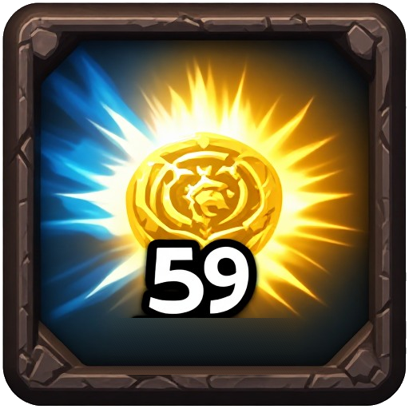

# Spell Buff Timers

A World of Warcraft add-on that shows how long your buffs have left **directly on the action bar button** of the spell that created them. Works for any class.

Instead of checking the buff icons in the corner of the screen, you can see at a glance when to re-cast a Seal, Blessing, Mark of the Wild, Arcane Intellect or any other self-buff.

## Features

- **Timers on your buttons:** a cooldown sweep and countdown on every action button whose icon matches an active buff on you.
- **Readable text:** `1h`, `59m` or plain seconds. The unit letter is half size and sits at the bottom right of the number, and everything stays inside the button.
- **Colour warning:** white until 2 seconds are left, then yellow fading to red, with a smooth decimal countdown (`1.99`, `1.98`, ... `0.00`).
- **Combat support:** the game blocks add-ons from reading buffs during combat. The add-on learns each buff's duration whenever it can read it, saves it, and starts the timer from your own cast during a fight.
- **ElvUI support:** works with the default Blizzard bars and ElvUI, and replaces ElvUI's own timer text on these buttons.

## Installation

1. Download this repository (Code > Download ZIP).
2. Copy the **`SpellBuffTimers`** folder (the one containing `SpellBuffTimers.toc`) into `World of Warcraft\_classic_\Interface\AddOns\`.
3. Restart the game, or type `/reload`.

The folder must be named exactly `SpellBuffTimers`.

## Commands

| Command | What it does |
| --- | --- |
| `/sbt` | Shows diagnostics (buffs found, buttons matched) |
| `/sbt max N` | Ignore buffs longer than N seconds (0 = off) |
| `/sbt min N` | Ignore buffs shorter than N seconds (0 = off) |
| `/sbt size N` | Set the timer number font size (0 = automatic) |
| `/sbt reset` | Clear the learned buff durations |

## Limitations

- Only buffs on **you** are tracked, not buffs you put on other players.
- During combat the add-on needs to have seen a buff once out of combat to know its duration.
- Buffs are matched to buttons by icon, which holds for nearly all buffs.

## Author

Stradios

## License

[MIT](LICENSE)
